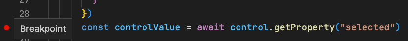
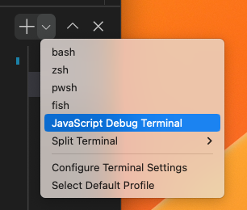
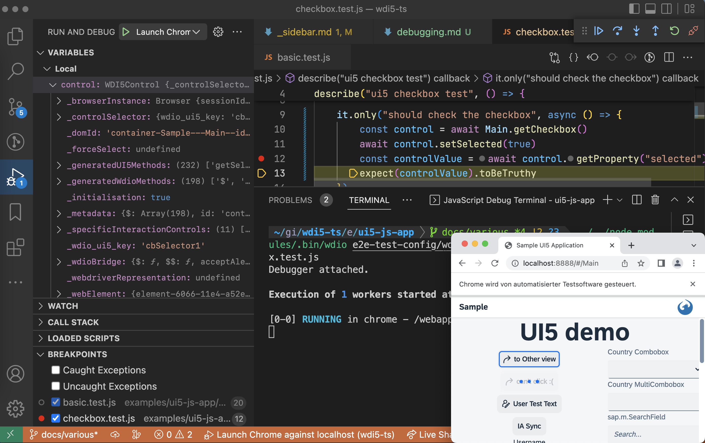

# Debugging `wdi5` tests

## Dialog lookup stalls with WebDriver BiDi

If a dialog is visible but `asControl()` or even a simple `browser.execute()` stalls with BiDi, check the application's console logging. In [issue #670](https://github.com/ui5-community/wdi5/issues/670), the Spreadsheet Importer's debug mode enabled `sap/base/Log.logSupportInfo(true)` and logged live controls, bindings and OData V4 models. UI5 writes these support objects to `console.info`; BiDi console events serialize the objects, which can traverse a large application graph and delay subsequent commands.

Prefer bounded diagnostic snapshots: record a control's type and ID or a model's type instead of passing the live instance to the console. For diagnosis, disable support information after the debug component has initialized and before opening the dialog:

```js
await browser.execute(async () => {
  const Log = await new Promise((resolve) => sap.ui.require(["sap/base/Log"], resolve))
  Log.logSupportInfo(false)
})
```

This keeps ordinary log messages enabled. An application may enable support information again when it creates another debug component. Classic WebDriver is a temporary workaround for this issue; increasing lookup timeouts does not remove the logging cost.

Also await UI5 method results in assertions: `expect(await dialog.isOpen()).toBe(true)`. Asserting the unresolved Promise can report success and leave a command running during cleanup.

## with VS Code

Add breakpoints in the test source:  


In the `Terminal` are of VS Code, start a "JavaScript Debug Terminal"...  
  
...and run `wdi5` from there...

- via `npm run wdi5` (or whatever npm script name you've chosen)
- directly via the `wdio` binary
  (in `/examples/ui5-js-app` of this repo)
  `$> npx wdio e2e-test-config/wdio-webserver.conf.js --spec /basic.test.js`

Subsequently `wdi5` will halt execution at that breakpoint and allows inspecting things in the Debugger pane:



?> for debugging tests, remember [to have a webserver running](running), serving the UI5 app under test
